# Tugas Praktikum 4 DPBO 2526 C2 (TP4DPBO2526C2)
Aplikasi Manajemen Data Personel Rumah Sakit (**PeopleData**) berbasis **Java Swing GUI** dengan fitur **CRUD (Create, Read, Update, Delete)** menggunakan IntelliJ IDEA Swing UI Designer.

---

## Janji

> Saya Muhammad Zidan Mirza Fedrieka dengan NIM 2507692 mengerjakan Tugas Praktikum 4 dalam mata kuliah Desain Pemrograman Berorientasi Objek untuk keberkahan-Nya maka saya tidak melakukan kecurangan seperti yang telah dispesifikasikan. Aamiin.

---

## 1. Desain dan Fungsi Program

### A. Diagram Class

Program **PeopleData** dibangun menggunakan dua class utama (`Person` dan `PeopleMenu`) serta satu file antarmuka visual (`PeopleMenu.form`):

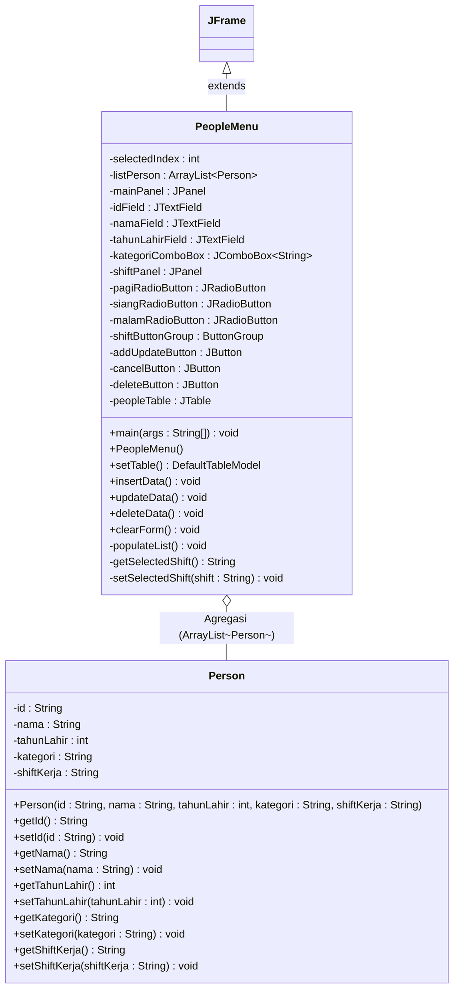

---

### B. Penjelasan Class, Atribut, dan Komponen GUI

#### 1. Class `Person` (`Person.java`)
Class model yang merepresentasikan entitas seorang personel/staf rumah sakit dengan menerapkan prinsip **Encapsulation** (atribut `private` beserta *getter* dan *setter* lengkap):
- `id` (`String`): Kode identitas unik personel (contoh: `"MED001"`).
- `nama` (`String`): Nama lengkap beserta gelar personel.
- `tahunLahir` (`int`): Tahun kelahiran personel (berupa bilangan bulat).
- `kategori` (`String`): Profesi atau jabatan personel di rumah sakit (`"Dokter Spesialis"`, `"Dokter Umum"`, `"Perawat"`, `"Apoteker"`, `"Staf Administrasi"`).
- `shiftKerja` (`String`): Jadwal shift kerja personel (`"Pagi"`, `"Siang"`, `"Malam"`) sebagai **atribut ke-5 tambahan**.

#### 2. Class `PeopleMenu` (`PeopleMenu.java` & `PeopleMenu.form`)
Class turunan `JFrame` yang mengatur tampilan antarmuka pengguna (GUI) dan seluruh logika pengolahan data:
- **Komponen Input Form:**
  - `idField` (`JTextField`): Kotak input untuk ID personel.
  - `namaField` (`JTextField`): Kotak input untuk Nama personel.
  - `tahunLahirField` (`JTextField`): Kotak input untuk Tahun Lahir (dilengkapi penanganan eksepsi `NumberFormatException`).
  - `kategoriComboBox` (`JComboBox<String>`): Dropdown pilihan kategori profesi.
  - `pagiRadioButton`, `siangRadioButton`, `malamRadioButton` (`JRadioButton` dalam `ButtonGroup`): Komponen pilihan **Shift Kerja** (komponen non-`JTextField` untuk atribut ke-5).
- **Komponen Tombol & Tabel:**
  - `addUpdateButton` (`JButton`): Tombol multifungsi yang bertuliskan `"Add"` saat mode tambah data baru (`selectedIndex == -1`) dan berubah menjadi `"Update"` saat salah satu baris tabel dipilih.
  - `cancelButton` (`JButton`): Tombol untuk mengosongkan input form dan membatalkan pilihan baris.
  - `deleteButton` (`JButton`): Tombol untuk menghapus data pada baris yang dipilih (disembunyikan saat tidak ada baris yang dipilih, dan dilengkapi dialog konfirmasi sebelum penghapusan).
  - `peopleTable` (`JTable` di dalam `JScrollPane`): Tabel untuk menampilkan seluruh data `listPerson`.

---

## 2. Penjelasan Alur Program (CRUD)

1. **Inisialisasi Program (Read / Tampil Data Awal):**
   - Method `main()` membuat objek `PeopleMenu`, mengatur ukuran jendela `700x600`, menempatkan jendela di tengah layar (`setLocationRelativeTo(null)`), dan mengatur warna latar putih.
   - Di dalam konstruktor `PeopleMenu()`, `listPerson` diinisialisasi dan diisi dengan 15 data awal melalui `populateList()`, lalu ditampilkan ke `peopleTable` menggunakan `setTable()`. Tombol `Delete` disembunyikan pada kondisi awal.

2. **Menambahkan Data Baru (Create / Insert) dan Error Handling:**
   - Pengguna mengisi `ID`, `Nama`, `Tahun Lahir`, memilih `Kategori` pada `JComboBox`, serta memilih `Shift Kerja` pada `JRadioButton`.
   - Saat tombol **Add** ditekan (`selectedIndex == -1`), method `insertData()` dijalankan dengan serangkaian validasi:
     - **Validasi Field Kosong:** Memastikan `ID`, `Nama`, dan `Tahun Lahir` tidak kosong. Jika kosong, muncul pop-up peringatan `"Semua field harus diisi!"`.
     - **Validasi Kategori:** Memastikan pengguna memilih opsi kategori selain pilihan default `"???"`. Jika belum memilih, muncul peringatan `"Silakan pilih kategori yang valid!"`.
     - **Validasi Keunikan ID (Unique ID):** Memeriksa melalui `isIdExist()` apakah ID sudah terdaftar di `listPerson`. Jika sudah ada, proses dibatalkan dan muncul peringatan `"ID '...' sudah terdaftar! Gunakan ID yang lain."`.
     - **Validasi Format Angka:** Mengonversi input `Tahun Lahir` dengan `Integer.parseInt()`. Jika input bukan angka, program menangkap `NumberFormatException` dan menampilkan pesan error `"Tahun lahir harus berupa angka!"`.
   - Jika seluruh validasi lolos, objek `Person` baru ditambahkan ke `listPerson`, tabel diperbarui dengan `setTable()`, form dibersihkan melalui `clearForm()`, dan muncul dialog informasi `"Data berhasil ditambahkan"`.

3. **Memilih dan Mengubah Data (Update):**
   - Saat pengguna mengklik salah satu baris pada `peopleTable`, event `mousePressed` akan menyimpan indeks baris ke `selectedIndex`.
   - Nilai `ID`, `Nama`, `Tahun Lahir`, `Kategori`, dan `Shift Kerja` dari baris tersebut otomatis dimasukkan ke masing-masing komponen form (`JTextField`, `JComboBox`, dan `JRadioButton`).
   - Teks tombol `Add` berubah menjadi **Update**, dan tombol **Delete** ditampilkan.
   - Saat tombol **Update** ditekan, method `updateData()` melakukan validasi yang sama (field tidak kosong, kategori valid, tahun lahir berupa angka, serta memastikan perubahan ID tidak bentrok dengan ID data milik orang lain di tabel).
   - Setelah validasi lolos, method `updateData()` memperbarui objek `Person` pada indeks `selectedIndex`, memuat ulang tabel, mereset form melalui `clearForm()`, dan menampilkan dialog `"Data berhasil diubah"`.

4. **Menghapus Data dengan Konfirmasi (Delete):**
   - Saat salah satu baris tabel dipilih dan pengguna menekan tombol **Delete**, program terlebih dahulu menampilkan **Confirmation Prompt** menggunakan `JOptionPane.showConfirmDialog()` dengan pesan `"Apakah Anda yakin ingin menghapus data ini?"` (pilihan **Yes / No**).
   - Jika pengguna memilih **Yes**, method `deleteData()` akan menghapus objek dari `listPerson.remove(selectedIndex)`, memperbarui tabel, memanggil `clearForm()`, dan menampilkan dialog `"Data berhasil dihapus"`. Jika memilih **No**, penghapusan dibatalkan.

5. **Mereset Form (Cancel):**
   - Saat tombol **Cancel** ditekan, method `clearForm()` mengosongkan seluruh `JTextField`, mengembalikan `kategoriComboBox` ke indeks `0`, mengembalikan `JRadioButton` ke `"Pagi"`, mengubah tombol kembali menjadi `"Add"`, menyembunyikan tombol `"Delete"`, dan mengatur `selectedIndex = -1`.

---

## 3. Dokumentasi Program (CRUD)

### 1. Tambah Data
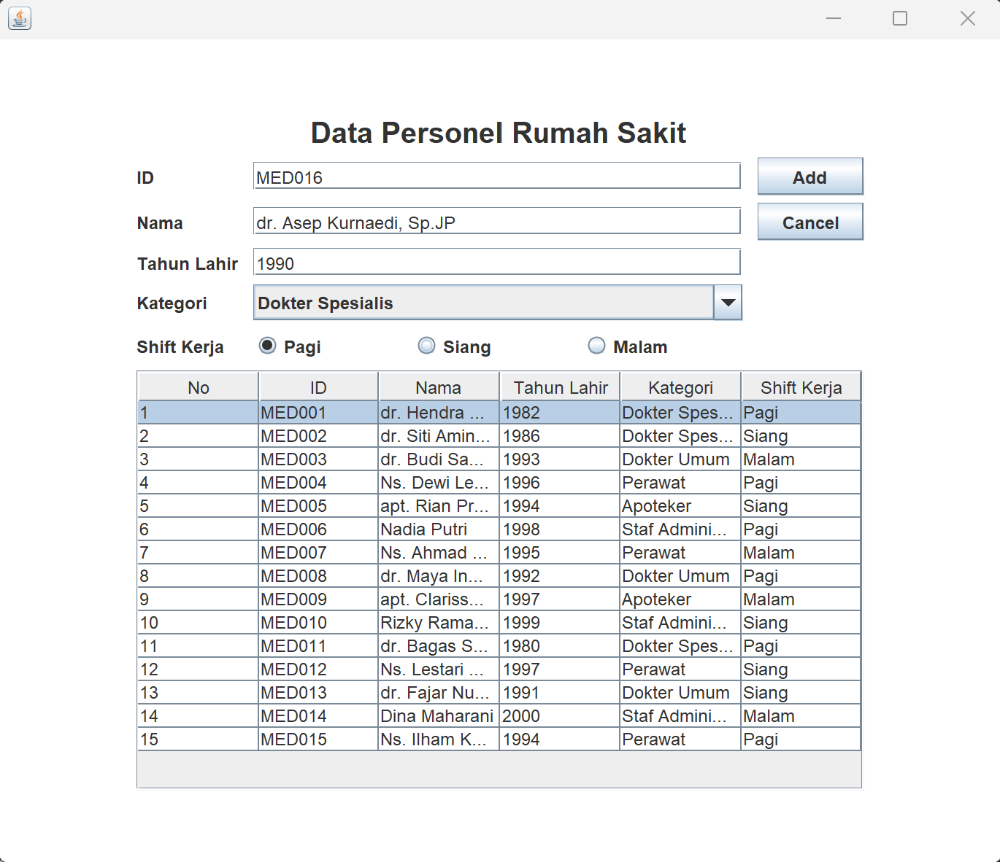
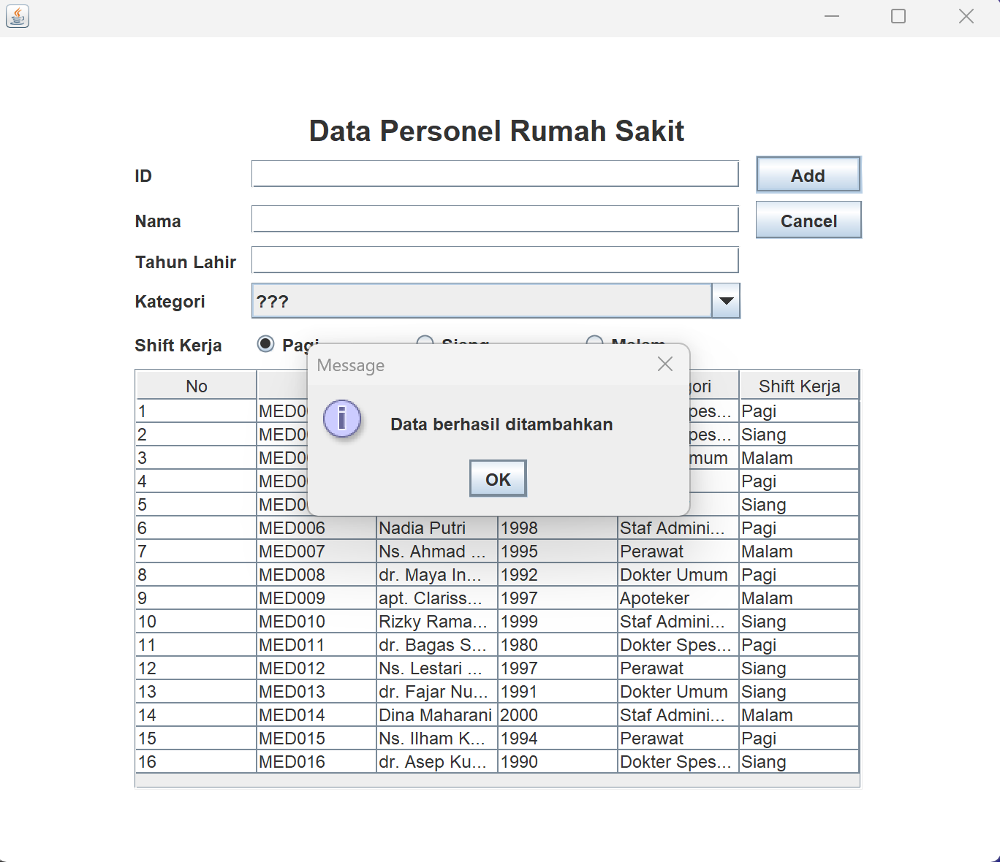

### 2. Hapus Data
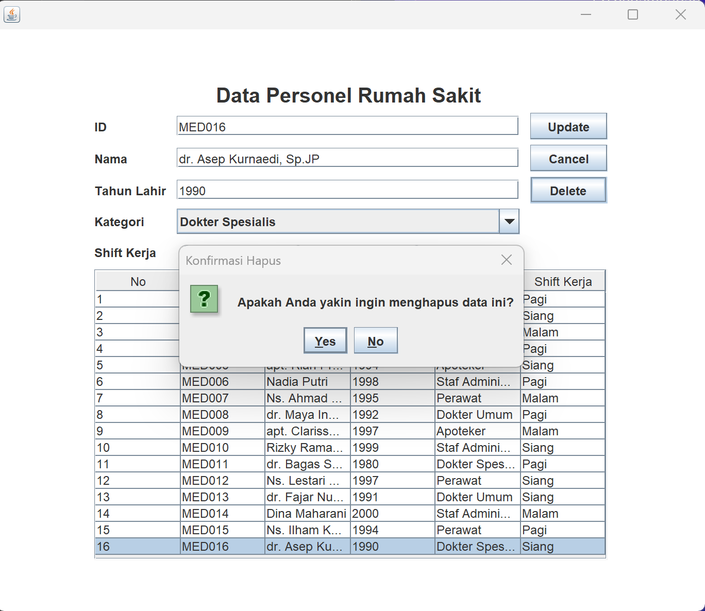
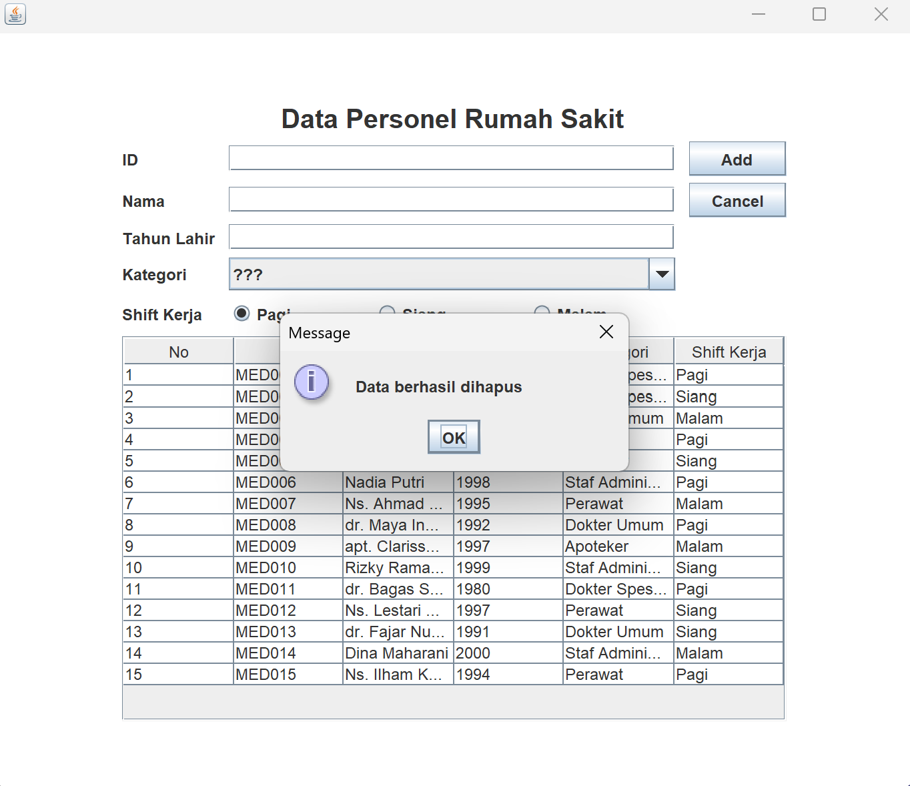

### 3. Update Data
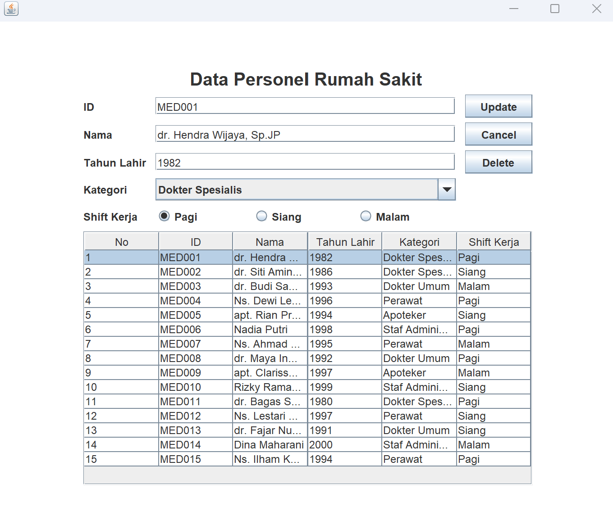
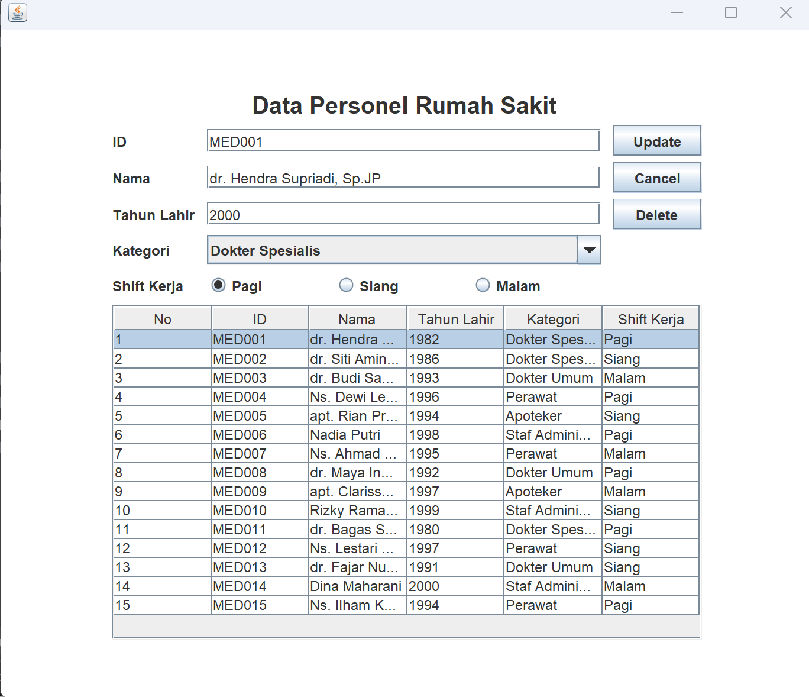
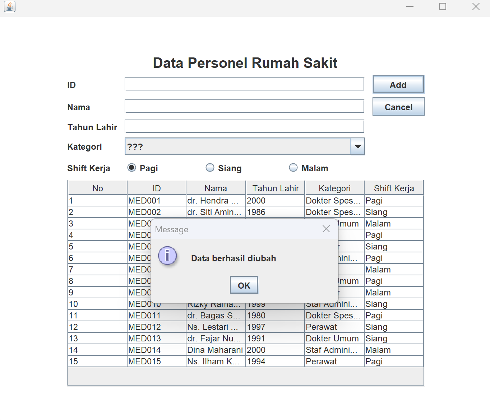

### 4. Eror Handling
#### 1 Field Kosong
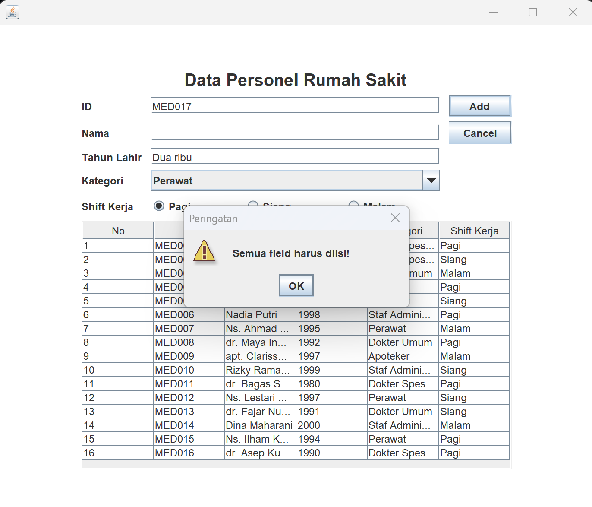

#### 2 ID telah digunakan
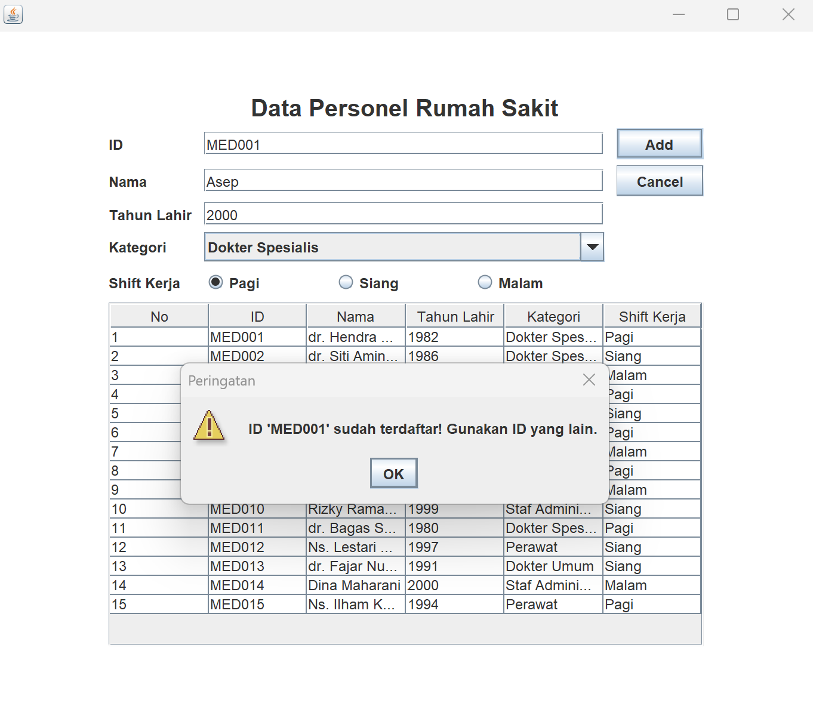

#### 3 Tipe Tahun Salah
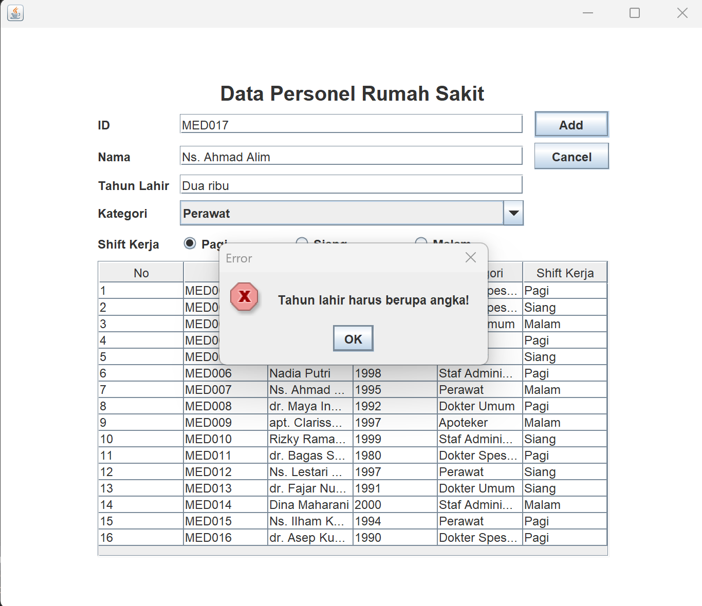

